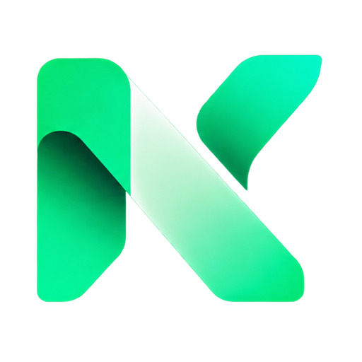

<p align="center">
  
</p>
<h1 align="center">Nextay Clip</h1>
<p align="center">A small, native clipboard history app for macOS.<br>Free and open source. Built by <a href="https://nextaysolutions.com/">NexTay Solutions</a>.</p>

Nextay Clip lives behind a paperclip in your menu bar. Copy text, choose it from the dropdown, and paste it wherever you need it. There is no main window at startup, no account, and no subscription.

## Requirements

- macOS 13 Ventura or later.
- Xcode Command Line Tools with Swift 5.9 or later, or a recent Xcode installation.
- No third-party dependencies.

## Build and run

```bash
git clone https://github.com/NexTay/clip.git
cd clip
# Only if developer tools are missing:
xcode-select --install
bash scripts/build-app.sh
open dist/NextayClip.app
```

The script builds a release executable, packages the company logo and app icon, creates a `.app` bundle, and signs it locally with an ad hoc signature.

To install, quit any running copy of Nextay Clip, then:

```bash
cp -R dist/NextayClip.app /Applications/
open /Applications/NextayClip.app
```

For launch at login, use the copy installed in Applications and enable the toggle in Settings. macOS may require approval under **System Settings → General → Login Items**. These source builds are locally signed, not Developer ID signed or notarized.

## Use the clipboard menu

| Action | How |
| --- | --- |
| Open history | Click the paperclip or press **⌘⇧V** |
| Copy a saved clip | Click its row; then press **⌘V** in the destination app |
| Copy one of the first nine clips | Press **⌘1–9** while the menu is open |
| Pin or unpin a clip | Hold **Option** while the menu is open, then choose its Pin/Unpin row |
| Delete an individual clip | Hold **Shift+Option** while the menu is open, then choose its Delete row |
| See older clips | Open **More Clips** at the end of the list |
| Pause or resume capture | Choose **Pause Monitoring** / **Resume Monitoring** |
| Open settings | Choose **Settings…** or press **⌘,** while the menu is open |
| Clear history | Choose **Clear History…**, then confirm; pinned clips are kept |
| Quit | Choose **Quit Nextay Clip** |

The menu uses native macOS materials and follows the system appearance. Long text is shortened in the menu; hover a clip to read its tooltip. The saved text keeps its line breaks. Re-copying the same text updates the existing clip rather than duplicating it.

## Settings

Settings opens only when requested. Changes are saved automatically and apply immediately.

| Setting | Options / default |
| --- | --- |
| Save copied text | On by default; pausing survives a restart |
| Launch at login | Off unless enabled through macOS; approval may be required |
| Keep recent clips | 50, 100, **250**, 500, or 1,000 unpinned clips |
| Delete unpinned clips after | **Never**, 1, 7, 30, or 90 days |
| Clips shown in menu | 10, **25**, or 50; additional clips go in More Clips |

Reducing a history limit or retention period removes matching unpinned clips immediately. Pinned clips do not count toward the recent-clip limit and do not expire. Age is measured from the last time that text was copied. Cleanup also runs at launch and approximately once a minute while the app is running.

**Show History in Finder** opens the local storage folder. Settings also includes the current saved-clip count, clear-history action, company website, source repository, and version.

## Privacy and storage

- Text only; images, files, and rich formatting are not stored.
- History is saved as **unencrypted JSON** at `~/Library/Application Support/NextayClip/history.json`.
- Preferences use macOS UserDefaults for `com.nextaysolutions.clip`.
- The app makes no network requests, collects no analytics, and has no cloud sync. Website/source links open in your browser only when clicked.
- Pause saving before copying sensitive information. Clearing history does not clear the system clipboard and is not a secure disk erase.
- Individual clips are capped at 100,000 characters. The app polls for text about every 0.55 seconds, so extremely rapid consecutive clipboard changes can be missed.
- Existing history from `NextayClipboard/history.json` is imported if no current history file exists.

To remove app data, quit Nextay Clip, remove the app from Applications, and delete the `NextayClip` Application Support folder. Remove any login item from macOS System Settings if still listed.

## Development and verification

```bash
# Regression checks; isolated test defaults and a unique test pasteboard
bash scripts/test.sh

# Release packaging, bundled assets, and local signing
bash scripts/build-app.sh

# Explicitly open Settings for development (normal launch stays in the menu bar)
open dist/NextayClip.app --args --settings
```

The standalone Swift test runner works with Command Line Tools without XCTest. It checks history limits, retention, persistence, pin preservation, pause/resume, duplicate handling, copying, clearing, and preference validation. It never reads your real clipboard history.

GitHub Actions builds and tests the project on macOS and uploads a locally signed app ZIP as a workflow artifact. That artifact is not a notarized installer.

Before submitting a change, also check the actual app: launch quietly, open the paperclip menu, copy and restore text, open Settings, change preferences, close Settings, and restart. Verify light/dark appearance and login behavior on your Mac. See [CONTRIBUTING.md](CONTRIBUTING.md).

## Troubleshooting

- **No main window after launching:** expected. Look for the paperclip in the menu bar; use **⌘⇧V** if the menu bar is crowded.
- **Shortcut does not open the menu:** another app may reserve **⌘⇧V**. Use the paperclip instead. This version has a fixed shortcut.
- **Launch at login fails:** install in Applications, open that copy, and retry. Check macOS Login Items for required approval.
- **History is empty:** check that saving is enabled and copy some text after launching. Copying images/files will not add entries.
- **Compiler or SDK errors:** update Command Line Tools or select an installed Xcode with a matching SDK using `xcode-select`.

## License and branding

Free to use, modify, and distribute under the [MIT License](LICENSE), including commercial use. NexTay Solutions branding identifies the original project; the license does not grant trademark rights or imply endorsement of forks. The included mark was supplied by NexTay Solutions and is also available from the [company website](https://nextaysolutions.com/icon.png).
